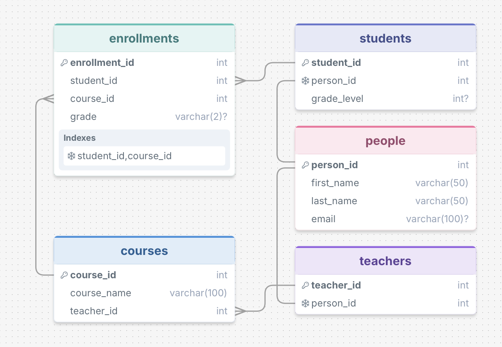

# School Database: Natural Language SQL

## Database purpose

This database represents a small school. It stores people and their student or teacher roles, the courses teachers teach, the students enrolled in each course, and each student's letter grade. The sample records are fictional.

## Schema picture



## Working example

Run the app using the instructions in [Run the app](#run-the-app).

**Question:** Which courses does Maya Chen take, and what grades does she have?

**Generated SQL:**
```sql
SELECT courses.course_name, enrollments.grade 
FROM people 
JOIN students ON people.person_id = students.person_id 
JOIN enrollments ON students.student_id = enrollments.student_id 
JOIN courses ON enrollments.course_id = courses.course_id 
WHERE people.first_name = 'Maya' AND people.last_name = 'Chen';
```

**Response:**
Maya Chen takes the following courses and has the corresponding grades:

- Algebra I: A
- Biology: B+
- World History: A-

## Example that did not work as expected

**Question:** Which students are most likely to get into college?

**Generated SQL or error:**
```sql
SELECT 'This question cannot be answered from the database.' AS message;
```

**Response:** This question cannot be answered from the database.

## More example questions

See [examples.md](examples.md) for at least six additional questions to try. To make this section part of your class post, include that file along with the code and database.

## Prompting strategies (Chang & Fosler-Lussier, 2023, arXiv:2305.11853)

I compared three prompt strategies on the same eight questions in [examples.md](examples.md), using the same school database and model. Each prompt generated SQL, the app ran the query, and the results were sent back to the model for a natural-language answer.

- **zero_shot:** the school schema and notes about the data, with no example question/SQL pairs.
- **single_domain:** the school schema and notes, plus two school-specific examples:
  - “Who teaches Algebra I?” → SQL joining `people`, `teachers`, and `courses`.
  - “What grade did Noah Patel get in Biology?” → SQL joining `people`, `students`, `enrollments`, and `courses`.
- **cross_domain:** the school schema and notes, plus two examples from a different domain:
  - “What dishes cost less than 10 dollars?” → SQL selecting from a restaurant `menu_items` table.
  - “How many orders has each customer placed?” → SQL joining restaurant `customers` and `orders`.

What I saw across the eight questions:

- **The results were correct in all three runs.** All eight questions returned the expected database results with zero-shot, single-domain, and cross-domain prompting. The examples did not improve correctness on this small, clearly named schema.
- **The SQL changed in small ways, while answers stayed consistent.** The strategies varied table aliases, join order, selected columns, and whether the result included a student name or ID. For “Which student has the most course enrollments?”, single-domain returned Maya Chen by name, while zero-shot and cross-domain returned student ID 1. They all pointed to the same student. The natural-language wording varied slightly but conveyed the same result.
- **Examples used more tokens.** Across the SQL-generation and answer-generation calls, API-reported total usage averaged about 488 tokens per question for zero-shot, 605 for single-domain (about 24% more), and 570 for cross-domain (about 17% more). For these eight questions, the extra example context did not improve the results.
- **The average-grade question showed the model can vary between runs.** In the earlier run recorded in [examples.md](examples.md), it generated invalid SQL. In these three strategy runs, it correctly queried the numeric `students.grade_level` field and returned an average of about 10.17. The examples.md question’s parenthetical says the data has grade labels rather than numeric scores; that note is misleading for grade level, because the schema stores grade level as a number. The letter grades are stored separately in `enrollments.grade`.

These results are from one small set of questions and one run per strategy. They show what happened in this experiment, not that the strategies will always perform equally.

## Run the app

Open Terminal and enter:

```bash
cd ~/Desktop/CS452/school_sql_app
python3 -m venv .venv
source .venv/bin/activate
pip install -r requirements.txt
```

Copy `.env.example` to `.env`, then open `.env` in a text editor and replace `your_api_key_here` with your own OpenAI API key. Do not share or commit `.env`.

Create the sample database if it does not exist, or rebuild it with the sample data:

```bash
python app.py --init
```

Start the question-and-answer app:

```bash
python app.py
```

Type a question at `Ask a question:` and press Return. The app prints the generated SQL and a plain-language answer. Ask another question at the next prompt; type `quit` to exit. The default model is `gpt-4o-mini`; if it is unavailable to your API account, change `OPENAI_MODEL` in `.env` to a model your account can use.